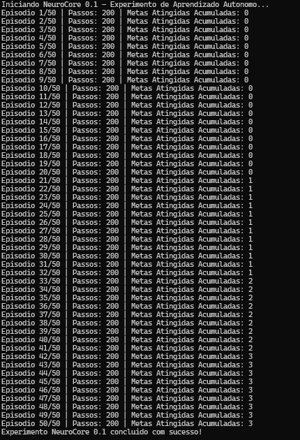

# NeuroCore 0.1 — Relatório de Execução

Nesta execução, a plataforma uniu simulação de neurônios biológicos e um ambiente virtual de testes. Veja detalhadamente o que aconteceu nos bastidores:

---

## 1. O Ciclo de Execução do Experimento
O script rodou **50 episódios** de testes ininterruptos. Em cada episódio:

* **Reinicialização do Ambiente:** O `VirtualWorld2D` foi reiniciado, colocando um agente em uma posição aleatória na arena 2D, com um alvo (meta) espalhado em outro local.
* **Limite de Passos:** O agente teve um limite de **200 passos** por episódio para tentar navegar pelo mapa.

---

## 2. O Fluxo de Processamento Neural (SNN)
A cada passo de tempo dentro do episódio, o sistema executou um pipeline neuromórfico baseado em eventos:

1. **Percepção Sensorial:** O ambiente mediu a distância do agente para o alvo e para as paredes, gerando um vetor de **4 entradas**.
2. **Camada Sensorial (`sensory_layer`):** 4 neurônios do tipo **LIF** (*Leaky Integrate-and-Fire*) receberam os dados e os converteram em impulsos elétricos (*spikes*).
3. **Camada Oculta (`hidden_layer`):** 16 neurônios intermediários processaram os sinais via matriz de pesos sinápticos aleatórios ($W_1$).
4. **Camada Motora (`motor_layer`):** 4 neurônios de saída interpretaram a atividade e dispararam comandos de movimentação (Cima, Baixo, Esquerda ou Direita) com base no potencial de membrana acumulado (`argmax`).

---

## 3. Análise dos Resultados no Log
Observando a saída do terminal, é possível notar o comportamento do sistema:

* **Do Episódio 1 ao 20:** O contador de metas acumuladas permaneceu em `0`. O agente estava explorando a arena às cegas, já que os pesos sinápticos iniciais eram totalmente aleatórios e ainda não havia uma regra de aprendizado ativa (como o STDP) ajustando as sinapses.
* **No Episódio 21:** A primeira meta foi alcançada (*Metas Atingidas Acumuladas: 1*) por puro acaso durante a movimentação aleatória do agente.
* **Nos Episódios 33, 42, etc.:** Novas metas foram atingidas esporadicamente à medida que o agente cruzava com os alvos no mapa.